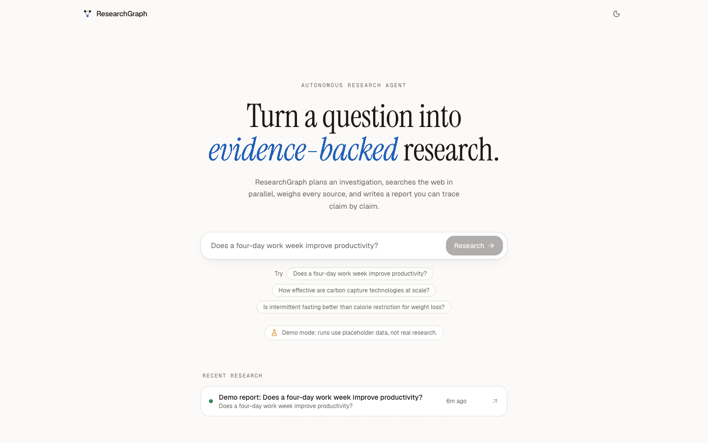
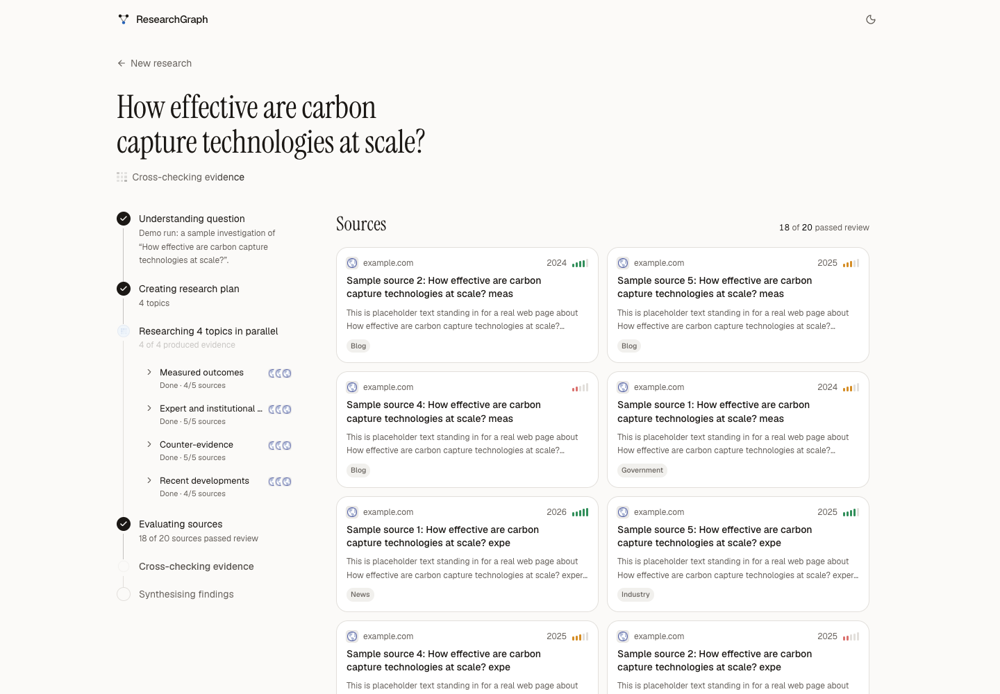
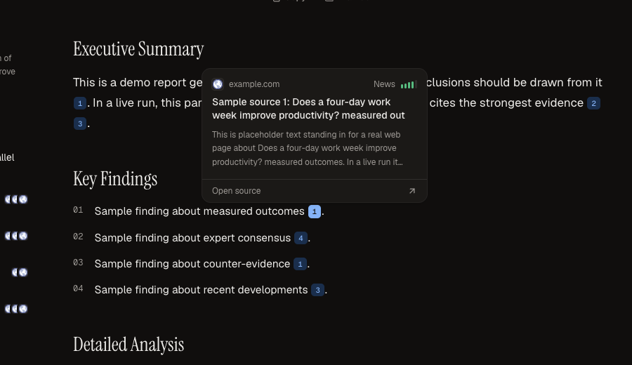
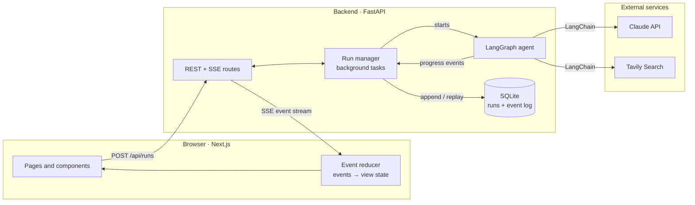
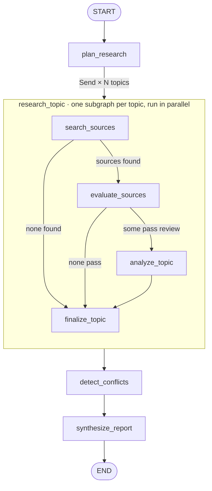
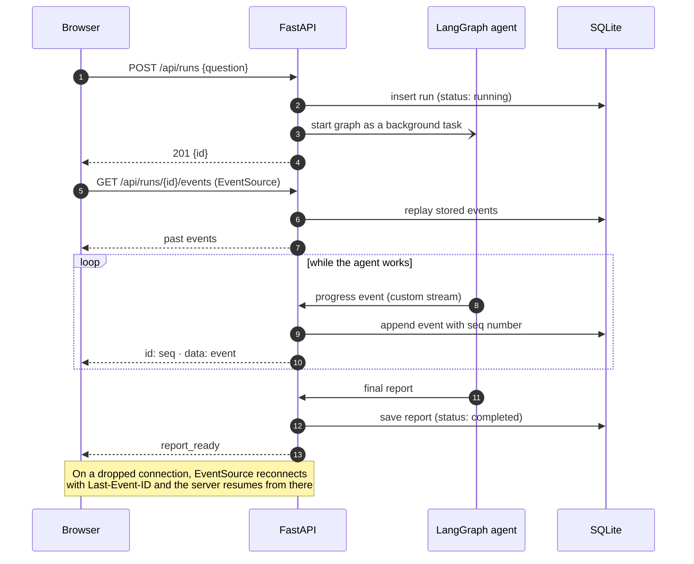
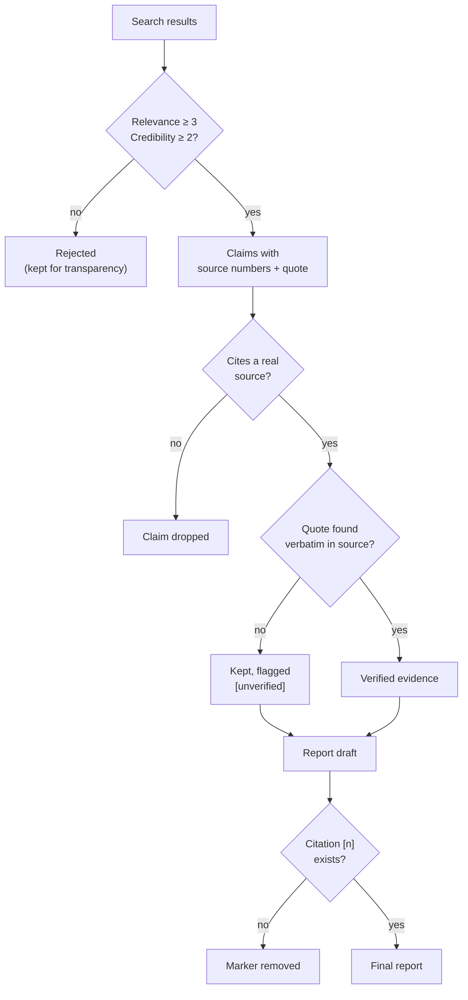

<div align="center">

# ResearchGraph

**Turn a question into evidence-backed research.**

An autonomous research agent that plans an investigation, researches topics in parallel,
scores every source, verifies its quotes, cross-examines conflicting claims, and writes a
report where every sentence links back to its evidence.

LangGraph · LangChain · Claude · Tavily · FastAPI · SQLite · Next.js 16 · Tailwind v4 · shadcn/ui



</div>

---

## Contents

- [What it does](#what-it-does)
- [Quick start](#quick-start)
- [Architecture](#architecture)
- [The agent graph](#the-agent-graph)
- [Lifecycle of a run](#lifecycle-of-a-run)
- [How answers stay grounded](#how-answers-stay-grounded)
- [Project structure](#project-structure)
- [API](#api)
- [Configuration](#configuration)
- [Testing](#testing)
- [Deployment](#deployment)
- [Design decisions](#design-decisions)
- [Limitations](#limitations)

---

## What it does

Ask a question, and the agent works through seven steps you can watch live:

| # | Step | What happens |
|---|------|--------------|
| 1 | **Plan** | Claude splits the question into up to 5 independent topics, each with its own search queries |
| 2 | **Search** | Every topic is researched **in parallel** with Tavily web search |
| 3 | **Evaluate** | Each source is scored for relevance and credibility; weak sources are filtered out |
| 4 | **Extract** | Claims are pulled from the surviving sources, each with a verbatim supporting quote |
| 5 | **Verify** | Quotes are checked against the source text in code; invented ones are flagged |
| 6 | **Cross-check** | Evidence is compared across topics to find genuine disagreements |
| 7 | **Synthesise** | A structured report is written; any citation the model invents is removed |

The result has an executive summary, key findings, detailed analysis, conflicting evidence,
limitations, a conclusion, and sources. Every `[n]` citation shows a preview of its source on
hover and jumps to the source card on click.

<table>
<tr>
<td width="50%"></td>
<td width="50%"></td>
</tr>
<tr>
<td align="center"><sub>Live progress: parallel topics and sources as they pass review</sub></td>
<td align="center"><sub>Citations: hover to preview the source, click to jump to it</sub></td>
</tr>
</table>

<sub>Screenshots are from demo mode, so the sources and findings shown are placeholders.
The full report page is in <a href="docs/images/report.png">docs/images/report.png</a>.</sub>

---

## Quick start

You need Python 3.11+ and Node 20+.

**1. Backend**

```bash
cd backend
python3 -m venv .venv
.venv/bin/pip install -e ".[dev]"
cp .env.example .env            # add ANTHROPIC_API_KEY and TAVILY_API_KEY
.venv/bin/uvicorn app.api.main:app --reload --port 8000
```

> **No API keys?** Set `DEMO_MODE=true` in `.env`. The real graph runs against a scripted
> model and search engine with placeholder data, and the UI shows a demo banner.

**2. Frontend**

```bash
cd frontend
npm install
npm run dev                     # http://localhost:3000
```

**Or run everything with Docker:** `docker compose up --build` (needs `backend/.env`).

**Or skip the UI:**

```bash
cd backend
.venv/bin/python -m app.cli "Do electric vehicles have lower lifetime emissions?" --out report.md
```

---

## Architecture

Two services and one SQLite file. The agent has no knowledge of HTTP, and the API has no
knowledge of how the agent works: they meet through a stream of events.



| Layer | Responsibility | Key files |
|-------|----------------|-----------|
| **Agent** | Orchestration, prompts, grounding checks | `backend/app/agent/` |
| **Services** | Thin adapters for Claude and Tavily behind small interfaces | `backend/app/services/` |
| **API** | Starts runs, stores events, streams them over SSE | `backend/app/api/` |
| **Frontend** | Turns the event stream into a live timeline and report | `frontend/src/` |

---

## The agent graph

LangGraph does the orchestration. The planner's output decides how many parallel branches
run; each branch is its own subgraph with private state.



| Node | Model call | What it produces |
|------|------------|------------------|
| `plan_research` | Claude | A `ResearchPlan`: topics and search queries |
| `search_sources` | none (Tavily) | Candidate sources, de-duplicated by URL |
| `evaluate_sources` | Claude, `effort=low` | 1–5 relevance and credibility scores; code applies thresholds |
| `analyze_topic` | Claude | Key points, each with a quote and source numbers |
| `finalize_topic` | none | One `TopicResult`, the subgraph's only output |
| `detect_conflicts` | Claude | Disagreements across topics, with a verdict |
| `synthesize_report` | Claude | The final report, citations validated |

**Three LangGraph ideas do the heavy lifting:**

- **`Send` for dynamic fan-out.** The number of branches comes from the plan at runtime, and
  all branches run in the same step.
- **Reducers for safe parallel writes.** `topic_results` is declared as
  `Annotated[list[TopicResult], operator.add]`, so branches append to it instead of
  overwriting each other.
- **Runtime context for dependencies.** The LLM and search clients are injected through
  `runtime.context`, not globals, so tests swap in fakes.

---

## Lifecycle of a run

Runs execute in the background. Every progress event is saved before it is sent, so a live
view, a refresh mid-run, and a finished report from history all use the same code path:
replay the event log.



**Events the browser receives:**

| Event | Sent when |
|-------|-----------|
| `run_started` | The run begins |
| `plan_ready` | The planner has chosen topics |
| `topic_started` / `sources_found` / `sources_evaluated` / `topic_completed` | Each parallel branch makes progress |
| `conflicts_started` / `conflicts_ready` | Cross-checking begins and ends |
| `synthesis_started` | The report is being written |
| `report_ready` / `run_failed` | The run ends (terminal) |

On the frontend, a single pure function (`reduceView` in
`frontend/src/lib/research-state.ts`) folds these events into everything the page shows.

---

## How answers stay grounded

The model is never the last line of defence. Each check is deterministic code that runs
after the model responds:



| Check | Where | Why |
|-------|-------|-----|
| Source quality thresholds and ranking | `nodes/evaluator.py` | The model rates; code decides, so rules are tunable and testable |
| Source numbers mapped back to URLs | `agent/evidence.py` | Models copy short numbers reliably; URLs they can garble |
| Quote verification (case, whitespace, and ellipsis tolerant) | `agent/evidence.py` | A fabricated quote is the clearest sign of a hallucinated claim |
| Invented citations stripped | `agent/citations.py` | Every `[n]` in the report must resolve to a source |

**Failures degrade instead of crashing the run.** If evaluation fails, the branch falls back
to the search engine's own ranking. A failed topic is reported while the others carry on.
Conflict detection is best-effort. A run with no usable evidence fails with a clear message
rather than producing an ungrounded report.

---

## Project structure

```
ResearchGraph/
├── backend/
│   ├── app/
│   │   ├── agent/
│   │   │   ├── graph.py          # parent graph + per-topic subgraph
│   │   │   ├── state.py          # shared state, reducers, subgraph state
│   │   │   ├── context.py        # injected dependencies
│   │   │   ├── schemas.py        # LLM output schemas + domain models
│   │   │   ├── prompts.py        # LangChain prompt templates
│   │   │   ├── nodes/            # planner, researcher, evaluator, conflicts, synthesizer
│   │   │   ├── evidence.py       # quote verification
│   │   │   ├── citations.py      # citation numbering + sanitising
│   │   │   └── events.py         # progress events for the UI
│   │   ├── services/
│   │   │   ├── llm.py            # StructuredLLM interface → Claude
│   │   │   └── search.py         # SearchClient interface → Tavily
│   │   ├── api/
│   │   │   ├── main.py           # routes, SSE endpoint, app factory
│   │   │   ├── runs.py           # background runs + live fan-out
│   │   │   └── store.py          # SQLite runs + event log
│   │   ├── demo.py               # scripted LLM/search for DEMO_MODE
│   │   ├── config.py
│   │   └── cli.py
│   ├── tests/                    # 42 tests, fully offline
│   └── Dockerfile
├── frontend/
│   ├── src/
│   │   ├── app/                  # routes: /  and  /research/[id]
│   │   ├── lib/research-state.ts # event reducer + derived timeline steps
│   │   ├── hooks/                # EventSource subscription
│   │   └── components/           # home, research timeline, report, citations
│   └── Dockerfile
├── docker-compose.yml
└── docs/images/
```

---

## API

| Method | Path | Description |
|--------|------|-------------|
| `POST` | `/api/runs` | Start research. Body: `{"question": "..."}` (3–500 chars). Returns `201` with the run |
| `GET` | `/api/runs` | Recent runs, newest first (`?limit=`, max 100) |
| `GET` | `/api/runs/{id}` | One run, including the report once completed |
| `GET` | `/api/runs/{id}/events` | Server-Sent Events: replays stored events, then streams live. Honours `Last-Event-ID` |
| `DELETE` | `/api/runs/{id}` | Delete a finished run (`409` while running) |
| `GET` | `/api/health` | `{status, configured, demo}` |

Errors: `422` invalid question · `429` too many concurrent runs · `503` server has no API keys.

---

## Configuration

Backend settings come from environment variables or `backend/.env`.

| Variable | Default | Purpose |
|----------|---------|---------|
| `ANTHROPIC_API_KEY`, `TAVILY_API_KEY` | — | Required for real research |
| `CLAUDE_MODEL` | `claude-opus-5-5` | Model used at every step |
| `CLAUDE_EFFORT` | `medium` | Default reasoning effort (source rating always uses `low`) |
| `CLAUDE_FALLBACKS` | `true` | Server-side fallback if a request is declined |
| `MAX_TOPICS` | `5` | Upper bound on parallel topics |
| `RESULTS_PER_QUERY` | `5` | Search results per query |
| `MAX_SOURCES_PER_TOPIC` | `6` | Sources kept after evaluation |
| `MAX_CONCURRENT_RUNS` | `3` | Protects your API quota |
| `DATABASE_PATH` | `researchgraph.db` | SQLite file |
| `CORS_ORIGINS` | `["http://localhost:3000"]` | Allowed frontend origins (JSON list) |
| `DEMO_MODE` | `false` | Placeholder data, no keys needed |

Frontend: `NEXT_PUBLIC_API_URL` (default `http://localhost:8000`).

---

## Testing

```bash
cd backend  && .venv/bin/pytest      # 42 tests: graph, parallelism, grounding, API, SSE, persistence
cd frontend && npx vitest run        # 12 tests: event reducer, timeline steps, citation parsing
```

The backend tests need no network or API keys. The agent's two dependencies are interfaces
(`StructuredLLM`, `SearchClient`), so the full graph runs against in-memory fakes in about a
second. The tests check behaviour that's easy to get wrong:

- topics really run concurrently
- a failed branch doesn't sink the run
- invented citations are removed
- fabricated quotes are flagged
- SSE resumes correctly from `Last-Event-ID`

---

## Deployment

| Part | Where | Notes |
|------|-------|-------|
| **Backend** | Render, Railway, Fly.io, or any Docker host | Use `backend/Dockerfile`. Mount a volume at `/data` for SQLite. Run **one instance**. Set your API keys and `CORS_ORIGINS` to the frontend URL |
| **Frontend** | Vercel, or `frontend/Dockerfile` | Set `NEXT_PUBLIC_API_URL` to the backend URL |

The SSE stream sends a keepalive every 15 s, so any proxy timeout above about 30 s works.

---

## Design decisions

| Decision | Why | Trade-off |
|----------|-----|-----------|
| LangGraph `Send` + reducers for parallelism | Real concurrency with merged state, not a sequential loop | Graph concepts to learn |
| One subgraph per topic | Each branch's working state stays private; only results flow back | Slightly more wiring |
| Model scores, code decides | Deterministic, unit-tested thresholds, tunable without prompt changes | Scores are coarse (1–5) |
| Native structured outputs (`method="json_schema"`) | Typed, validated responses; current Claude models reject forced tool calls | — |
| Per-call `effort` | Cheap, fast `low` effort for rating sources; default effort for reasoning | — |
| Append-only event log in SQLite | Replay, history, and reconnects from one mechanism; no Redis or queue | Single API instance |
| SSE instead of WebSockets | One-way updates, plain HTTP, built-in browser reconnect | Server → client only |
| Pure reducer on the frontend | Live view and history share one code path; trivially testable | — |
| `DEMO_MODE` | Demo and develop without keys, while running the real graph | Placeholder content |

**Scaling past one instance** would mean moving the event fan-out to Postgres
`LISTEN/NOTIFY` or Redis pub/sub, and the run store to Postgres. The agent itself is
unchanged.

---

## Limitations

- **Snippets, not full pages.** Sources are judged on the extracts Tavily returns, not on
  full documents.
- **Recency is recorded, not scored.** Publication year appears in labels but doesn't affect
  ranking.
- **One process.** Runs, live signalling, and SQLite share a single backend instance (see
  above).
- **No authentication.** Anyone with the URL can start runs; `MAX_CONCURRENT_RUNS` is the
  only guard on API spend.

---

## UI components

Built on shadcn/ui and Radix, with components adapted from copy-paste libraries. Each file
notes what was changed.

| Component | Source |
|-----------|--------|
| Agent "thinking" indicator | [BoardUI](https://www.boardui.com) |
| Question input with cycling placeholders | [Aceternity UI](https://ui.aceternity.com) |
| Morphing word in the headline | [VengeanceUI](https://www.vengenceui.com) |
| Shimmer text, theme toggle | [beUI](https://beui.dev) |
| Entrance fades, dot background, counters | [Magic UI](https://magicui.design) |
| Buttons, hover cards, tooltips, collapsibles | [shadcn/ui](https://ui.shadcn.com) |
